<picture>
  <source media="(prefers-color-scheme: dark)" srcset="./dark.svg">
  <source media="(prefers-color-scheme: light)" srcset="./light.svg">
  
</picture>

## About

I'm a 2nd-year B.Tech student interested in machine learning, problem-solving, and building practical software. I learn by implementing concepts, solving problems, and turning them into small real-world projects.

**Currently exploring:** Machine Learning · Java · DSA · Python

## Focus

- **Machine Learning**: Python, data preprocessing, model development, and core ML algorithms
- **Data Structures & Algorithms**: Java, working through LeetCode and NeetCode 150
- **Data tooling**: NumPy, Pandas, and Matplotlib
- **Building**: projects that put each concept into practice

## Featured Projects

| Project | Description | Language |
| --- | --- | --- |
| [dsa-java](https://github.com/veerdevelops/dsa-java) | A structured journey through DSA in Java, from core fundamentals and Striver's A2Z to LeetCode and NeetCode 150 | Java |
| [machine-learning](https://github.com/veerdevelops/machine-learning) | Learning and implementing ML concepts with Python, NumPy, Pandas, Matplotlib, and scikit-learn, from fundamentals to practical projects | Jupyter Notebook |

## Tech Stack

| Area | Tools |
| --- | --- |
| Languages | Java, Python |
| ML & Data | NumPy, Pandas, SciPy, scikit-learn, Matplotlib |
| Databases | MySQL, Microsoft SQL Server, SQLite |
| Web & Visualization | Node.js, Jinja, Chart.js |
| Design | GIMP |

## Connect

- GitHub: [@veerdevelops](https://github.com/veerdevelops)

<!--
Add these once you have the exact values (they were listed on your old profile without usable URLs):
- LinkedIn: https://www.linkedin.com/in/<your-exact-slug>   (the old link contained a space, which LinkedIn URLs can't have)
- Email: your@email
- Instagram: https://instagram.com/<your-handle>
-->
